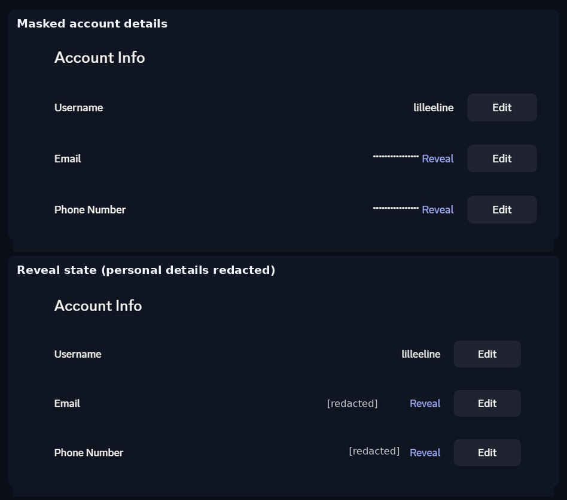

# AccountPrivacy

Mask displayed email and phone details on Discord's **My Account** settings page.

Maintained by [@yrdn576-lgtm](https://github.com/yrdn576-lgtm).

## Screenshots

**Masked account information and Reveal state**

*The example screenshot has been edited to remove personal account details. Masking is a display feature, not a security boundary.*

## Installation

This repository contains Vencord **userplugin source code**. It is not a standalone plugin package for the standard Vencord Installer.

1. Set up a Vencord source checkout using the official Vencord development instructions.
2. Copy the `accountPrivacy` folder into `src/userplugins/`.
3. From the Vencord repository root, run `pnpm test:ts` and `pnpm build --dev`.
4. Follow Vencord's official instructions to install/activate your locally built version. Building alone does not install it into Discord.
5. Enable **AccountPrivacy** in Vencord's plugin settings.

Back up your existing setup before replacing an installed Vencord build. Do not run commands you do not understand.

## Notes

- Discord UI changes may require updates to this plugin's selectors.
- The plugin masks the displayed values; it is not a security boundary and does not remove account details from Discord or its underlying page data.
- Compatibility has not been independently verified against every Vencord/Discord version.

## License

GPL-3.0-or-later. See [LICENSE](LICENSE).
